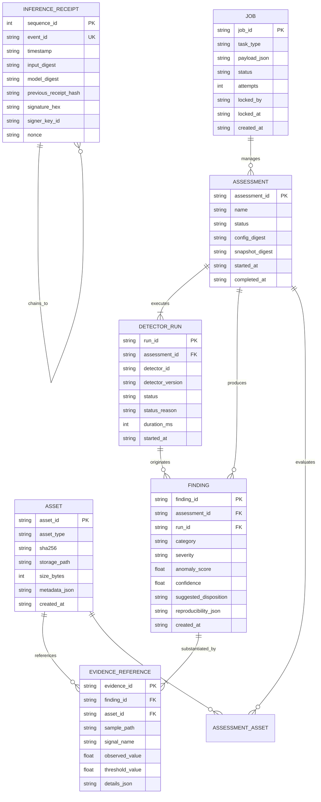
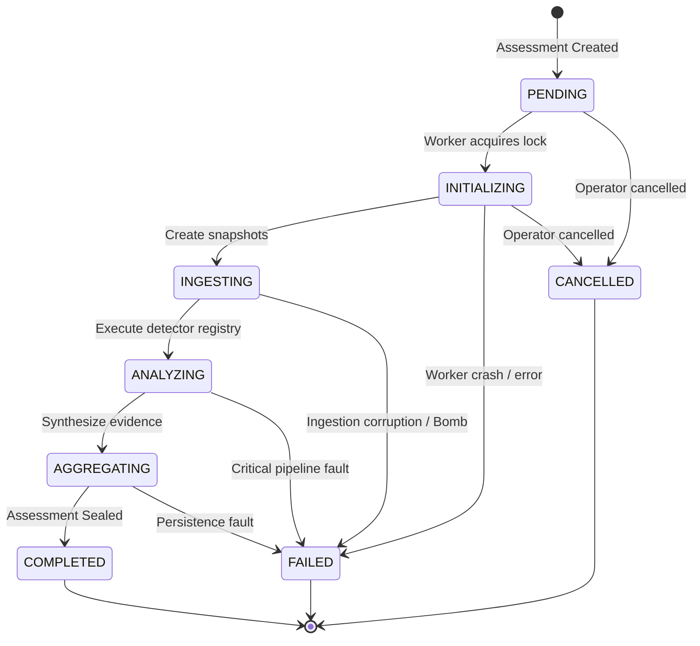

# VisionGuard Data, Asset & Findings Model Specification

**Document Version:** 1.0.0 (Consolidated & Locked)  
**Status:** Authoritative Data Architecture Standard  
**Date:** November 2026  
**Architect:** Senior Software Architect & AI Security Engineer  
**Scope:** Canonical domain entities, content-addressed dataset snapshots, manifest schemas, universal finding structure, job state machines, and capability-aware reporting.

---

## 1. Domain Entities & Database Schema Overview

VisionGuard utilizes an embedded SQLite database (`visionguard.db`) for relational metadata, job orchestration, finding queries, and receipt chains, paired with content-addressed filesystem storage for binary blobs and immutable snapshots.



---

## 2. Content-Addressed Asset & Snapshot Model

All assets stored in VisionGuard are content-addressed by their SHA-256 byte digests.

### 2.1 Supported Asset Types
- `DATASET_ARCHIVE`: Raw compressed user archives (`.zip`, `.tar.gz`) stored in quarantine.
- `DATASET_SNAPSHOT`: Validated, normalized, immutable directory structure ready for detection analysis.
- `MODEL_CHECKPOINT`: PyTorch state dictionary or full checkpoint file (`.pt`, `.pth`).
- `REFERENCE_SET`: Approved, authenticated baseline feature distributions used for OOD and drift comparison.
- `PROVENANCE_MANIFEST`: Signed or unsigned metadata JSON files linking sample paths to source batches or contributors.

### 2.2 Dataset Snapshot Structure & Directory Layout
When an untrusted archive is extracted, validated, and normalized, VisionGuard writes it to an **immutable snapshot**:
```text
data/processed/snapshots/<snapshot_id>/
├── manifest.json            # Canonical, lexicographically sorted path-to-SHA256 index
├── metadata.json            # Snapshot creation metadata, format dialect, class mapping
├── images/                  # Normalized image files (e.g., 000001.jpg, 000002.png)
└── annotations/             # Canonical format-specific annotations (instances.json, labels/)
```

### 2.3 Path-to-SHA256 Snapshot Manifest Specification
The `manifest.json` file binds every sample in the snapshot to its exact byte digest:
```json
{
  "manifest_version": "1.0.0",
  "snapshot_id": "snap_9f86d081884c7d659a2feaa0c55ad015a3bf4f1b2b0b822cd15d6c15b0f00a08",
  "created_at": "2026-11-10T18:45:00Z",
  "dataset_format": "COCO_DETECTION",
  "total_files": 5000,
  "total_bytes": 1048576000,
  "files": [
    {
      "relative_path": "annotations/instances.json",
      "sha256": "4b227777d4dd1fc61c6f884f48641d02b4d121d3fd328cb08b5531fcacdabf8a",
      "size_bytes": 1542000
    },
    {
      "relative_path": "images/000000000001.jpg",
      "sha256": "e3b0c44298fc1c149afbf4c8996fb92427ae41e4649b934ca495991b7852b855",
      "size_bytes": 204512
    },
    {
      "relative_path": "images/000000000002.jpg",
      "sha256": "3a7bd3e2360a3d29eea436fcfb7e44c735d117c42d1c1835420b6b9942dd4f1b",
      "size_bytes": 198400
    }
  ]
}
```

#### Sealing Rules:
1. `files` array must be sorted strictly by `relative_path` in ascending UTF-8 byte order.
2. The entire snapshot is identified by the `snapshot_digest = SHA256(manifest.json)` computed over canonical RFC 8785 JSON bytes.
3. Once generated, all files in the directory are set to read-only permissions (`0444` on Linux/macOS or read-only ACL on Windows). Modification of any file invalidates the `snapshot_digest`.

---

## 3. Universal Finding Schema

Every detector that produces an issue, alert, or finding must instantiate the universal `Finding` schema.

### 3.1 JSON Schema Specification (`Finding`)
```json
{
  "$schema": "https://json-schema.org/draft/2020-12/schema",
  "title": "VisionGuardFinding",
  "type": "object",
  "required": [
    "finding_id",
    "assessment_id",
    "detector_id",
    "detector_version",
    "category",
    "severity",
    "title",
    "description",
    "affected_assets",
    "evidence",
    "detector_config",
    "status",
    "reproducibility",
    "suggested_disposition"
  ],
  "properties": {
    "finding_id": {
      "type": "string",
      "format": "uuid"
    },
    "assessment_id": {
      "type": "string",
      "format": "uuid"
    },
    "run_id": {
      "type": "string",
      "format": "uuid"
    },
    "detector_id": {
      "type": "string",
      "example": "data_integrity.near_duplicate"
    },
    "detector_version": {
      "type": "string",
      "example": "1.0.0"
    },
    "category": {
      "type": "string",
      "enum": [
        "CORRUPTED_FILE",
        "STRUCTURAL_DEFECT",
        "DUPLICATE_SAMPLE",
        "SPLIT_LEAKAGE",
        "LABEL_ANOMALY",
        "OUT_OF_DISTRIBUTION",
        "SUSPECTED_POISON",
        "UNAUTHORIZED_MODEL_CHANGE",
        "INFERENCE_TAMPERING",
        "DISTRIBUTION_SHIFT"
      ]
    },
    "severity": {
      "type": "string",
      "enum": ["INFORMATIONAL", "LOW", "MEDIUM", "HIGH", "CRITICAL"]
    },
    "title": {
      "type": "string"
    },
    "description": {
      "type": "string"
    },
    "anomaly_score": {
      "type": ["number", "null"],
      "minimum": 0.0
    },
    "confidence": {
      "type": ["number", "null"],
      "minimum": 0.0,
      "maximum": 1.0
    },
    "affected_assets": {
      "type": "array",
      "items": {
        "type": "object",
        "required": ["asset_id", "sample_path", "sha256"],
        "properties": {
          "asset_id": { "type": "string" },
          "sample_path": { "type": "string" },
          "sha256": { "type": "string" }
        }
      }
    },
    "evidence": {
      "type": "array",
      "items": {
        "type": "object",
        "required": ["signal_name", "observed_value", "threshold_value", "rationale"],
        "properties": {
          "signal_name": { "type": "string" },
          "observed_value": { "type": "number" },
          "threshold_value": { "type": "number" },
          "rationale": { "type": "string" },
          "feature_coordinates": { "type": ["array", "null"] }
        }
      }
    },
    "detector_config": {
      "type": "object"
    },
    "status": {
      "type": "string",
      "enum": [
        "COMPLETED",
        "NOT_APPLICABLE",
        "UNAVAILABLE",
        "SKIPPED",
        "FAILED",
        "TIMED_OUT",
        "INCONCLUSIVE",
        "CONFLICTED"
      ]
    },
    "reproducibility": {
      "type": "object",
      "required": ["seed", "software_versions", "timestamp"],
      "properties": {
        "seed": { "type": ["integer", "null"] },
        "software_versions": { "type": "object" },
        "timestamp": { "type": "string", "format": "date-time" }
      }
    },
    "suggested_disposition": {
      "type": "string",
      "enum": ["ACCEPT", "REVIEW", "QUARANTINE"]
    }
  }
}
```

---

## 4. Assessment Lifecycle & Job Execution State Machine

### 4.1 Assessment State Transitions
Assessments represent holistic audit evaluations. They follow a strictly non-cyclical lifecycle:



### 4.2 SQLite-Backed Job Queue (`jobs`)
Rather than introducing Celery or Redis dependencies, VisionGuard implements an atomic SQLite job queue:
- **Table Definition:** `jobs(job_id, task_type, payload_json, status, attempts, locked_by, locked_at, created_at, updated_at)`
- **Lease Acquisition:** A background worker process claims tasks using SQLite atomic transactions with timeouts:
  ```sql
  UPDATE jobs 
  SET status = 'RUNNING', locked_by = :worker_id, locked_at = datetime('now')
  WHERE job_id = (
      SELECT job_id FROM jobs 
      WHERE status = 'QUEUED' 
      ORDER BY created_at ASC 
      LIMIT 1
  );
  ```
- **Crash Recovery:** Tasks locked for longer than 300 seconds without heartbeat updates are considered abandoned, unlocked, and incremented in `attempts` up to a maximum retry limit of 3 before transitioning to `FAILED`.

---

## 5. Explicit Capability Reporting & Status Model

VisionGuard enforces radical epistemic honesty in reporting detector coverage. Detectors never default to passing scores when unexecuted or broken.

### 5.1 Formal Capability Execution States

| Capability Status | Exact Semantic Meaning | Action / Output | Reporting Contract |
|---|---|---|---|
| `COMPLETED` | Detector prerequisites were satisfied, algorithm executed to completion, and signals were computed. | Signals evaluated against thresholds; findings generated if anomalous. | Appears in coverage matrix as executed. |
| `NOT_APPLICABLE` | The dataset or artifact format does not support this check (e.g., bounding box geometry on a pure classification dataset). | Omitted cleanly. | Explicitly marked as not applicable with format justification. |
| `UNAVAILABLE` | Mandatory prerequisites were missing (e.g., Spectral Signatures requested on a dataset without a trained model checkpoint, or checkpoint sandbox missing). | Marked unavailable; mandatory `status_reason` string recorded. | **NEVER counted as clean or passing.** Displayed prominently as an unfulfilled assurance gap. |
| `SKIPPED` | Detector was manually disabled in the assessment configuration by operator policy. | Not executed. | Recorded as skipped by user directive. |
| `FAILED` | Detector crashed due to an unhandled exception or mathematical non-convergence (e.g., SVD failed). | Structured error logged; stack trace captured safely without secrets. | **NEVER converted into a passing result.** Marked as execution failure. |
| `TIMED_OUT` | Execution exceeded the hard configured limit (e.g., 30s per batch). | Subprocess terminated via `SIGKILL`. | Recorded as timed out with resource metrics. |
| `INCONCLUSIVE` | Algorithm executed, but sample volume was too small for statistical power (e.g., LOCO Bayes on $N_i < 10$). | Finding generated with tentative label; max disposition capped at `REVIEW`. | Clear disclaimer: `INSUFFICIENT_DATA_FOR_DEFINITIVE_ATTRIBUTION`. |
| `CONFLICTED` | Multiple active detectors produced contradictory conclusions (e.g., pHash indicates duplicate, but feature distance indicates OOD). | Both findings preserved; synthesized finding tagged `CONFLICTED`. | **Conflicting outputs remain visible.** The system never silently averages or discards one signal. |

---

## 6. Inference Receipt Schema & Canonical Wire Format

### 6.1 Receipt JSON Schema (`InferenceReceipt`)
```json
{
  "receipt_version": "1.0.0",
  "sequence_id": 10452,
  "event_id": "c7a8b89e-5e92-411a-9f44-98442886f77a",
  "timestamp": "2026-11-10T18:45:00.123456Z",
  "nonce": "d8e8fca2dc0f896fd7cb4cb0031ba249",
  "signer_key_id": "ed25519_edge_node_01",
  "input_digest": "3a7bd3e2360a3d29eea436fcfb7e44c735d117c42d1c1835420b6b9942dd4f1b",
  "model_digest": "4b227777d4dd1fc61c6f884f48641d02b4d121d3fd328cb08b5531fcacdabf8a",
  "config_digest": "e2b0c44298fc1c149afbf4c8996fb92427ae41e4649b934ca495991b7852b855",
  "output_payload": {
    "predicted_class": 3,
    "confidence": 0.9842,
    "logits": [0.001, 0.002, 0.005, 0.984, 0.004, 0.001, 0.001, 0.001, 0.001, 0.000]
  },
  "previous_receipt_hash": "9f86d081884c7d659a2feaa0c55ad015a3bf4f1b2b0b822cd15d6c15b0f00a08",
  "signature_hex": "b3e0c4...[128 hex chars]..."
}
```

### 6.2 Canonical Serialization Rules
When hashing or signing receipts, the payload (excluding `signature_hex`) is serialized under **RFC 8785**:
1. Sorted keys: `config_digest`, `event_id`, `input_digest`, `model_digest`, `nonce`, `output_payload`, `previous_receipt_hash`, `receipt_version`, `sequence_id`, `signer_key_id`, `timestamp`.
2. Floats serialized according to IEEE 754 canonical JSON numbers without exponents where represented exactly.
3. Ed25519 signature computed over canonical UTF-8 bytes and appended as `signature_hex`.
