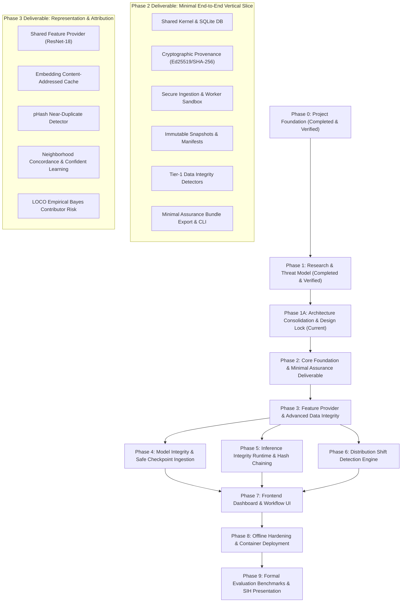

# VisionGuard Consolidated Implementation Roadmap

**Document Version:** 1.0.0 (Consolidated & Locked)  
**Status:** Authoritative Implementation Roadmap  
**Date:** November 2026  
**Architect:** Senior Software Architect & AI Security Engineer  
**Scope:** Phase-by-phase engineering delivery plan, module dependencies, acceptance criteria, security verification protocols, and scope management rules.

---

## 1. Roadmap Strategy & Engineering Methodology

VisionGuard follows a strict **vertical slice and architectural layering strategy**. In accordance with core engineering standards:
1. **No Parallel Module Chaos:** We do not attempt to implement all four integrity modules simultaneously.
2. **Infrastructure First:** Shared Kernel, cryptographic provenance, secure ingestion, and immutable snapshots must be fully validated before writing detector algorithms.
3. **Epistemic Honesty:** Backdoor detection remains an experimental capability requiring explicit prerequisites; it will never be marketed as a guaranteed security feature without controlled validation.
4. **Verifiable Testing:** No phase is marked completed without passing automated unit tests, integration tests, and security boundary assertions.

---

## 2. Phase-by-Phase Implementation Roadmap

---

## 3. Phase Specifications, Deliverables & Exit Criteria

### Phase 0: Project Foundation & Backend Initialization
- **Status:** **COMPLETED & VERIFIED (November 2026)**
- **Delivered:** Python 3.11 environment, FastAPI scaffolding, Pydantic settings, structlog logging, SQLite persistence setup, initial unit tests (9/9 passed), Ruff linting/formatting verified.

### Phase 1: Research, Threat Modeling & Technical Specifications
- **Status:** **COMPLETED & VERIFIED (November 2026)**
- **Delivered:** Exhaustive threat model, dataset licensing audit (CIFAR-10, GTSRB, COCO, VOC), PyTorch security advisories audit (CVE-2025-32434, CVE-2026-24747, GHSA-v32g-mr63-3j83), decoupled calibration protocols, LOCO Bayesian edge cases, binary CIFAR-10 ingestion contract.

### Phase 1A: Architecture Consolidation & Design Lock
- **Status:** **CURRENT PHASE (November 2026)**
- **Delivered:** Consolidated architectural specification, ports and adapters design, minimal detector plugin interface, authoritative security architecture, universal finding schema, and implementation roadmap.

---

### Phase 2: Core Foundation & Minimal Assurance Deliverable
*This is the first substantial engineering implementation deliverable. It delivers a complete, verifiable end-to-end slice.*

#### Engineering Scope:
1. **Shared Kernel Implementation:**
   - Universal domain entities: `Asset`, `Assessment`, `DetectorRun`, `Finding`, `EvidenceReference`.
   - SQLite migrations creating `assets`, `assessments`, `detector_runs`, `findings`, `evidence_references`, and `jobs`.
   - Minimal common detector plugin registry (`DetectorPlugin`, `DetectorRegistry`).
   - SQLite-backed asynchronous job worker polling `jobs` table with task lease locking.
2. **Cryptographic Provenance Engine:**
   - Canonical JSON serialization implementation complying strictly with RFC 8785 (JCS).
   - SHA-256 streaming digest service for files and buffers.
   - Ed25519 key generation, encrypted file storage (`0400` permissions), and digital signing/verification via Python `cryptography`.
   - Standalone offline verification CLI tool (`visionguard-verify`).
3. **Secure Ingestion Module & Worker Subprocess:**
   - Quarantine storage manager (`data/quarantine/`).
   - Isolated archive decompression worker with strict defense limits: max 50,000 files, max 10 GB uncompressed, max 10:1 ratio, path traversal rejection (`../`), symlink/hardlink rejection, Windows reserved name filtering.
   - Image validation: magic byte verification (JPEG, PNG), Pillow decompression bomb protection (`MAX_IMAGE_PIXELS = 40M`).
   - Format adapters: `COCODatasetAdapter`, `YOLODatasetAdapter`, `FolderPerClassAdapter`, and `CIFAR10BinaryAdapter`.
4. **Immutable Dataset Snapshot Engine:**
   - Snapshot builder moving validated files to content-addressed storage (`data/processed/snapshots/<snapshot_id>/`).
   - Lexicographically sorted `manifest.json` generation and SHA-256 snapshot digest sealing.
5. **Tier-1 Data Integrity Detectors:**
   - `ExactDuplicateDetector`: SHA-256 byte collision detection within splits and cross-split leak detection (`CRITICAL_SPLIT_LEAKAGE`).
   - `AnnotationGeometryValidator`: Format-specific bounding box validation (COCO absolute pixel boundaries vs. YOLO normalized unit coordinates).
6. **Minimal End-to-End Orchestrator & Assurance Export:**
   - Orchestration service executing Ingestion $\to$ Snapshot $\to$ Tier-1 Detectors $\to$ Findings Assembly $\to$ Signed Assurance Bundle export (`bundle.tar.gz`).
   - Independent bundle verification using `visionguard-verify` CLI.

#### Acceptance Criteria & Security Validation:
- [ ] Archive containing `../../evil.sh` traversal path is rejected with `PATH_TRAVERSAL_DETECTED`.
- [ ] Recursive decompression bomb (zip bomb) is terminated and rejected before exceeding 10 GB limit.
- [ ] Windows reserved names (`CON.png`, `NUL.txt`) are rejected without process hanging.
- [ ] Truncated or corrupt image headers are rejected with `CORRUPTED_OR_DISGUISED_FILE`.
- [ ] Exact duplicate images are grouped with 100% precision; cross-split duplicates trigger `CRITICAL_SPLIT_LEAKAGE`.
- [ ] COCO coordinates with $x_{\min} + w > W_{\text{image}}$ trigger `COCO_BOUNDING_BOX_OUT_OF_BOUNDS`.
- [ ] YOLO coordinates outside $[0.0, 1.0]$ trigger `YOLO_COORDINATE_OUT_OF_RANGE`.
- [ ] Exported assurance bundle verifies successfully using `visionguard-verify` CLI on a clean air-gapped machine.
- [ ] Tampering with a single byte in the snapshot invalidates bundle verification with `SIGNATURE_VERIFICATION_FAILED`.

---

### Phase 3: Shared Feature Provider & Advanced Data Integrity
#### Engineering Scope:
1. **Shared Feature Provider:**
   - Centralized embedding extraction using frozen, locally provisioned PyTorch ResNet-18 weights.
   - Content-addressed embedding cache keyed by `(image_sha256, backbone_name, weights_sha256)`.
2. **Tier-2 & Tier-3 Data Integrity Detectors:**
   - `NearDuplicateDetector`: Perceptual hashing (pHash) with 64-bit DCT and calibrated Hamming threshold $\tau_H$.
   - `NeighborhoodConcordanceDetector`: Deep embedding $k$-NN concordance $C_k$ with adaptive $k = \max(3, \min(15, \lfloor 0.1 \cdot N_c \rfloor))$.
   - `ConfidentLearningDetector`: Out-of-fold predicted probability matrix analysis for label flipping.
   - `DatasetContaminationDetector`: $k$-NN Euclidean distance to reference holdouts $\mathcal{D}_{\text{ref}}$.
   - `ContributorRiskAnalyzer`: LOCO empirical Bayes shrinkage with hyperparameter sensitivity sweeps ($M \in \{5, 20, 50\}$).

#### Acceptance Criteria & Security Validation:
- [ ] Re-running assessments on previously embedded datasets incurs zero neural network forward passes (cache hit rate 100%).
- [ ] pHash achieves true duplicate recall while maintaining $FPR \le 0.1\%$ across calibrated hard-negative pairs.
- [ ] Single-sample contributors ($N_i = 1$) shrink toward baseline prior without false quarantine.
- [ ] Missing provenance metadata gracefully falls back to sample-only reporting.

---

### Phase 4: Model Integrity & Safe Checkpoint Ingestion
#### Engineering Scope:
1. **Sandboxed Checkpoint Loader:**
   - Subprocess worker executing `torch.load(weights_only=True)` under OS memory quotas (2 GB max) and 30-second kill timeout.
   - Capability gating: Host lacking required isolation reports `status: UNAVAILABLE`.
2. **Model Integrity Detectors:**
   - Model file SHA-256 matching against approved release manifests.
   - Post-load tensor-only state-dict verification.
   - Behavioral fingerprinting on deterministic probe suites ($M=100$ fixed seed probes).
   - Experimental backdoor analyzers (Spectral Signatures singular vector projection, Activation Clustering PCA/silhouette analysis).

#### Acceptance Criteria & Security Validation:
- [ ] Checkpoint with astronomical dimension headers ($[10^6, 10^6, 10^6]$) is rejected by DoS pre-checks.
- [ ] Checkpoint containing executable Python bytecode is rejected by `weights_only=True` without code execution.
- [ ] Unsandboxed execution on platforms lacking process isolation returns `status: UNAVAILABLE`.
- [ ] Re-saved model with identical weights is recognized via state-dict comparison despite byte differences.
- [ ] Backdoor detection is reported with capability prerequisites; unexecuted checks report `UNAVAILABLE`.

---

### Phase 5: Inference Integrity Runtime & Hash Chaining
#### Engineering Scope:
1. **Lightweight Runtime Client (`visionguard-runtime`):**
   - Standalone, zero-dependency package installable on edge nodes.
   - Captures inputs, model digests, outputs, sequence IDs, and nonces.
   - Signs receipts via Ed25519 using local private key.
2. **Inference Audit Engine:**
   - Receipt ingestion and Ed25519 signature verification against registered public keys.
   - Hash-chain verification (`previous_receipt_hash` continuity, monotonic sequence numbers).
   - Tamper detection tests (dropped, reordered, replayed, or altered receipts).

#### Acceptance Criteria & Security Validation:
- [ ] Replayed receipts with duplicated nonces are rejected.
- [ ] Dropped receipts trigger `RECEIPT_SEQUENCE_GAP_DETECTED`.
- [ ] Altered output logits or confidence values invalidate Ed25519 verification.

---

### Phase 6: Distribution Shift Detection Engine
#### Engineering Scope:
1. **Covariate & Semantic Shift Detectors:**
   - Leverages Feature Provider embeddings to evaluate incoming operational batches against baseline reference sets.
   - Non-parametric statistical tests: Maximum Mean Discrepancy (MMD) with Gaussian RBF kernels, Kolmogorov-Smirnov (KS) tests on feature projections, Wasserstein distances.
2. **Reporting Discipline:**
   - Reports distinguish distribution drift from model accuracy degradation.

#### Acceptance Criteria & Security Validation:
- [ ] Clean in-distribution holdout batches produce no false drift alerts.
- [ ] Known semantic shifts (e.g., adverse weather, synthetic corruptions) trigger shift alerts with statistical $p$-values.

---

### Phase 7: Unified Frontend Dashboard & Reporting UI
#### Engineering Scope:
- React + TypeScript SPA providing responsive dashboards:
  - Asset management and dataset upload.
  - Assessment configuration and execution monitoring (via polling / SSE).
  - Finding inspection with evidence drilldown.
  - Capability coverage matrix (visualizing all 8 capability states).
  - Human-in-the-loop disposition workflow (`ACCEPT`, `REVIEW`, `QUARANTINE`).
  - Assurance bundle download.

#### Acceptance Criteria:
- [ ] Zero blocking or freezing during heavy background assessments.
- [ ] Conflicting detector signals are highlighted in the UI without masking.

---

### Phase 8: Offline Hardening & Container Deployment
#### Engineering Scope:
- Docker build with multi-stage layers:
  - Python 3.11 slim base image with pre-installed wheel cache.
  - Local PyTorch CPU / CUDA binaries.
  - Pre-staged ResNet-18 frozen weights.
  - Outbound networking disabled in container configuration (`--network none`).
- Comprehensive air-gapped installation guide and backup/restore scripts for `visionguard.db`.

#### Acceptance Criteria:
- [ ] Container launches and runs complete assessment with physical ethernet/wifi disconnected.

---

### Phase 9: Benchmark Evaluation Suite & Final Portfolio Presentation
#### Engineering Scope:
- Execution of formal evaluation protocol defined in `docs/EVALUATION_PLAN.md` across CIFAR-10, GTSRB, COCO, and Pascal VOC.
- Empirical latency, peak VRAM, and memory measurements on target hardware (NVIDIA RTX 3050 / CPU).
- Publication of final portfolio report and presentation assets.
