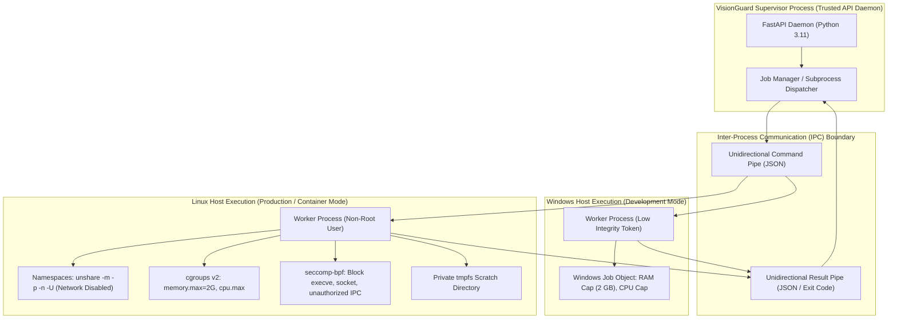
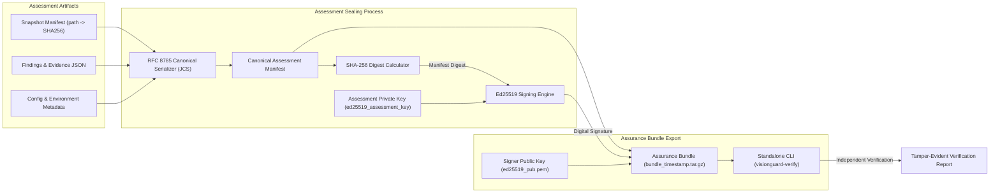
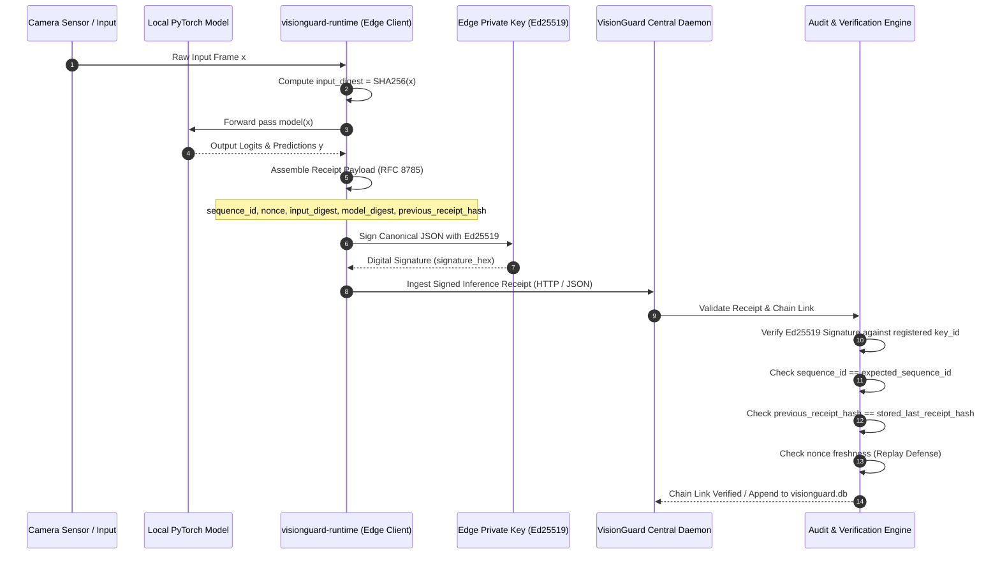

# VisionGuard Security Architecture & Threat Boundary Specification

**Document Version:** 1.0.0 (Consolidated & Locked)  
**Status:** Authoritative Security Architecture Standard  
**Date:** November 2026  
**Architect:** Senior Software Architect & AI Security Engineer  
**Scope:** Threat boundaries, trust assumptions, defensive ingestion guardrails, worker isolation models, safe checkpoint loading policies, cryptographic provenance, key management, and inference receipt semantics.

---

## 1. Threat Boundaries & Trust Assumptions

VisionGuard assumes a **zero-trust model** regarding all external inputs. Computer vision datasets, model checkpoints, edge inference logs, and operator-submitted files are untrusted by default.

```mermaid
graph TD
    subgraph UntrustedZone["Untrusted External Zone"]
        ExtDataset["Untrusted Dataset Archives (.zip, .tar.gz)"]
        ExtModel["Untrusted Model Checkpoints (.pt, .pth)"]
        ExtProvenance["Untrusted Metadata / Provenance JSON"]
        ExtReceipts["Untrusted Edge Ingestion Payloads"]
    end

    subgraph QuarantineZone["Quarantine & Isolation Zone (Untrusted Execution)"]
        QuarantineFS["Quarantine Storage (data/quarantine/)"]
        WorkerProcess["Isolated Worker Subprocess (Restricted Token / Namespaces)"]
        TempScratch["Ephemeral Scratch tmpfs (Wiped on Exit)"]
    end

    subgraph TrustedCoreZone["Trusted Core Monolith Zone"]
        FastAPIDaemon["FastAPI Core Daemon (backend.app)"]
        OrchestratorSvc["Assessment Orchestrator & Domain Services"]
        FeatureBackbone["Feature Provider (Frozen ResNet-18)"]
        RiskEngine["Risk & Evidence Synthesis Engine"]
        CryptoEngine["Cryptographic Signing Engine"]
    end

    subgraph TrustedStorageZone["Protected Local Persistence"]
        SQLiteDB[("SQLite Database (visionguard.db)")]
        SnapshotFS["Immutable Content-Addressed Snapshots (0444 Read-Only)"]
        KeyStore["Local Cryptographic Key Store (File Permissions 0400)"]
    end

    subgraph OutOfBandZone["Out-of-Band Verification Boundary"]
        AssuranceBundle["Sealed Assurance Bundle (.tar.gz)"]
        OfflineCLI["Standalone Verification CLI (visionguard-verify)"]
        ExternalAudit["Air-Gapped Auditor Workstation"]
    end

    ExtDataset -->|Upload Stream| QuarantineFS
    ExtModel -->|Upload Stream| QuarantineFS
    ExtProvenance -->|Ingest| QuarantineFS
    ExtReceipts -->|Inference API| FastAPIDaemon

    QuarantineFS --> WorkerProcess
    WorkerProcess --> TempScratch
    WorkerProcess -->|Validated Artifact Stream (IPC)| OrchestratorSvc

    OrchestratorSvc --> FeatureBackbone
    OrchestratorSvc --> RiskEngine
    RiskEngine --> CryptoEngine

    CryptoEngine --> KeyStore
    OrchestratorSvc --> SQLiteDB
    OrchestratorSvc --> SnapshotFS

    CryptoEngine --> AssuranceBundle
    AssuranceBundle --> OfflineCLI
    OfflineCLI --> ExternalAudit
```

### 1.1 Formal Trust Assumptions
1. **Host Operating System:** The underlying OS kernel (Windows or Linux) is assumed to correctly enforce process boundaries, file permissions, and system call filtering when configured.
2. **Local Administrator / Root Compromise:** If an attacker achieves root or Administrator privileges on the VisionGuard host, all software-based controls (including local SQLite databases, in-memory signing keys, and filesystem permissions) are compromised. Defense-in-depth relies on **out-of-band export** of signed audit checkpoints to air-gapped immutable storage.
3. **Model Deserialization Risk:** Arbitrary PyTorch checkpoints can contain executable Python bytecodes or trigger C++ memory corruptions. Checkpoint deserialization must be treated as untrusted code execution.
4. **Metadata & Provenance Unreliability:** Metadata strings (e.g., `contributor_id` in `provenance.json`) are untrusted unless cryptographically signed with a verified Ed25519 key.

---

## 2. Dataset Ingestion Security Architecture

Dataset archives (`.zip`, `.tar.gz`) frequently serve as vectors for path traversal, host filesystem corruption, and resource exhaustion attacks (Zip Bombs).

### 2.1 Blind Extraction Prohibition
VisionGuard strictly prohibits blind, automated archive extraction (e.g., calling standard library `shutil.unpack_archive()` or `tarfile.extractall()` without filters). All extractions execute inside an ephemeral worker subprocess following a strict multi-stage inspection algorithm.

### 2.2 Defensive Ingestion Guardrails & Resource Limits

| Defense Control | Operational Limit / Specification | Violation Handling | Security Objective |
|---|---|---|---|
| **Max Archive Size** | 250 MB per uploaded archive file | Rejection (`FILE_SIZE_LIMIT_EXCEEDED`) | Prevents disk space exhaustion. |
| **Max Uncompressed Size** | 10 GB total extracted content | Rejection (`DECOMPRESSION_SIZE_EXCEEDED`) | Defends against recursive zip bombs. |
| **Max File Count** | 50,000 files per archive | Rejection (`ENTRY_COUNT_EXCEEDED`) | Defends against inode exhaustion and DoS. |
| **Max Compression Ratio** | 10:1 uncompressed-to-compressed ratio | Rejection (`SUSPECTED_DECOMPRESSION_BOMB`) | Blocks high-ratio zip bomb payloads. |
| **Path Traversal Defenses** | Rejects `../`, `..\\`, absolute paths (`/`, `C:\`) | Rejection (`PATH_TRAVERSAL_DETECTED`) | Confines extraction strictly to sandbox directory. |
| **Link Rejection** | Symlinks, hardlinks, directory links rejected | Rejection (`LINK_NOT_PERMITTED`) | Prevents filesystem escape and arbitrary file reading. |
| **Windows Reserved Names** | Rejects `CON`, `PRN`, `AUX`, `NUL`, `COM1-9`, `LPT1-9` | Rejection (`WINDOWS_RESERVED_NAME_DETECTED`) | Prevents Windows OS handle hanging and crashes. |
| **Alternate Data Streams** | Rejects colon character (`:`) in file paths | Rejection (`ALTERNATE_DATA_STREAM_DETECTED`) | Prevents hidden payload execution on NTFS filesystems. |
| **Trailing Dots & Spaces** | Strips or rejects trailing dots (`.`) and spaces | Rejection (`INVALID_FILENAME_TERMINATION`) | Blocks NTFS filename aliasing bypasses. |
| **Image Decompression Bombs** | Max 40,000,000 pixels ($8000 \times 5000$) | Rejection (`IMAGE_DECOMPRESSION_BOMB_DETECTED`) | Pillow `MAX_IMAGE_PIXELS` stops allocation exhaustion. |
| **Magic Byte Validation** | Enforces JPEG `\xFF\xD8\xFF` and PNG `\x89PNG\r\n\x1a\n` | Rejection (`CORRUPTED_OR_DISGUISED_FILE`) | Blocks polyglot and disguised executables. |

### 2.3 Isolated Image Decoding
Untrusted image files are decoded exclusively within the isolated worker process. Decoded arrays are verified for dimension, channel count (RGB), and data type (`uint8`) before transfer across the IPC boundary to the core application daemon.

---

## 3. Checkpoint Ingestion & Safe Loading Policy

### 3.1 Strict Prohibition of `weights_only=False`
> **MANDATORY SECURITY DIRECTIVE:**  
> Calling `torch.load(..., weights_only=False)` on untrusted model files is **STRICTLY PROHIBITED**. Standard PyTorch unpickling executes arbitrary Python bytecode via the `__reduce__` exploit mechanism, enabling complete remote code execution (RCE).

### 3.2 Upstream PyTorch Deserialization Advisories & Version Enforcement
VisionGuard recognizes that `weights_only=True` is not a complete security sandbox. Upstream vulnerabilities in PyTorch unpickling and native C++ archive parsing have proven that type restrictions can be circumvented:
- **CVE-2025-32434:** PyTorch deserialization bypass in `torch.load(weights_only=True)` allowing arbitrary object instantiation via nested object graphs in PyTorch $< 2.5.1 / 2.6.0$. Runtime must be $\ge 2.6.0$ or patched baseline.
- **CVE-2026-24747 (GHSA-63cw-57p8-fm3p):** Integer overflow during tensor buffer calculation in the native C++ unpickler in PyTorch versions $\le 2.9.1$, causing unpickler memory corruption and potential arbitrary code execution. Patched in PyTorch $\ge 2.10.0$.
- **GHSA-v32g-mr63-3j83:** PyTorch advisory published November 10, 2026. Reported affected versions $\ge 2.14.0$, reported patched in $2.15.0$. Identifies potential arbitrary file read during `torch.load(weights_only=True)`. Noted as a newly published AI-assisted advisory with no package listed, tracked for upstream confirmation. Current installed environment `torch==2.15.0+cpu` satisfies the 2.15.0 patch baseline and must not be downgraded.

### 3.3 Defense-in-Depth Safe Loading Protocol
1. **Pre-Load Digest Verification:** Candidate checkpoint SHA-256 digest is streamed and verified against an approved release manifest before attempting deserialization.
2. **Pre-Load Archive Size Limit:** Hard file size limit ($\le 2$ GB) enforced prior to parsing.
3. **Static AST & Opcode Inspection as Heuristics:** Static parsing of pickle bytecodes is executed as an early filter. However, pickle bytecode is a Turing-complete stack machine; static inspection is treated strictly as an **advisory heuristic**, never proof of safety.
4. **Isolated Subprocess Deserialization:** Checkpoint loading executes inside an isolated worker subprocess with OS memory quotas and a 30-second kill timeout.
5. **Post-Load State-Dict Verification:** Loaded root object must strictly be an instance of Python `dict` mapping string keys to `torch.Tensor` instances. Custom Python objects are rejected immediately. Tensor dimension headers are verified against architecture limits ($\le 2048 \times 2048 \times 3$) to prevent Denial-of-Service allocation bombs.

---

## 4. Worker Isolation Architecture

VisionGuard enforces multi-layer isolation between the main API supervisor and untrusted worker subprocesses.



### 4.1 Windows Development Mode vs. Hardened Linux Execution
VisionGuard explicitly differentiates between resource throttling on Windows and hardened isolation on Linux:

#### Windows Development Mode:
- **Resource Controls (Job Objects):** Windows Job Objects enforce hard RAM limits (2 GB) and CPU cycle quotas, terminating processes exceeding quotas.
- **Security Boundary Reality:** **Windows Job Objects are resource controls, NOT complete security boundaries.** They do not provide unshared filesystem namespaces or automated network virtualization. Windows isolation relies on running the worker under a `Low Integrity Level` token or `AppContainer` context with network sockets disabled and filesystem ACLs restricting write access strictly to an ephemeral scratch folder.

#### Hardened Linux Execution (Container / Production):
- **User & Process Isolation:** Worker runs as an unprivileged non-root user with `no-new-privileges` enforced.
- **Namespace Virtualization:** Executes within isolated Linux namespaces:
  - Mount namespace (`unshare -m`): Root filesystem mounted strictly read-only (`ro`).
  - Network namespace (`unshare -n`): Network severed with zero network interfaces or routes (loopback disabled).
  - PID namespace (`unshare -p`): Worker cannot view or signal host processes.
  - User namespace (`unshare -U`): Worker user mapped to unprivileged host identity.
- **Scratch Filesystem:** Write operations permitted only within a private, memory-backed `tmpfs` scratch directory wiped immediately upon process exit.
- **System Call Filtering:** Seccomp-bpf profile blocking `execve`, socket creation (`socket`, `connect`, `bind`), and unauthorized IPC.
- **Resource Quotas:** cgroups v2 enforcing hard memory limit (`memory.max = 2G`) and CPU execution caps, backed by a 30-second supervisor timeout with `SIGKILL`.

### 4.2 Capability Gating on Sandbox Failure
If the deployment host environment cannot verify adequate process isolation, network severance, or filesystem controls (e.g., executing in an unprivileged container without namespace capabilities, or on Windows without Job Object / Low Integrity token access), VisionGuard **strictly refuses to execute untrusted checkpoint deserialization** and marks the capability:
- `status: UNAVAILABLE`
- `reason: "Host platform lacks proven process sandboxing, network severance, or filesystem isolation controls required for untrusted checkpoint deserialization"`

---

## 5. Cryptographic Provenance & Assurance Bundle Specification



### 5.1 Artifact Identity vs. Authenticity
- **Locally Calculated SHA-256:** Establishes **artifact identity** (verifying that local bytes match an expected hash). It does **NOT establish authenticity** unless compared against a trusted, independent external source (e.g., official academic checksums or an Ed25519-signed release manifest).
- **Digital Signatures (Ed25519):** Provide cryptographic authenticity, integrity, and non-repudiation using Twisted Edwards curve Ed25519 via Python `cryptography`.

### 5.2 Canonical Serialization Standard (RFC 8785 JCS)
To prevent cross-platform signature verification failures caused by JSON whitespace, key ordering, or number representation differences, all signed payloads adhere to **RFC 8785 (JSON Canonicalization Scheme)**:
1. **Key Ordering:** Object keys sorted lexicographically by UTF-8 byte order at all nesting levels.
2. **Whitespace:** Zero insignificant whitespace (strict `,` and `:` separators without surrounding spaces).
3. **Character Encoding:** Strict UTF-8 without Byte Order Mark (BOM); characters escaped according to RFC 8785 rules.
4. **Number Formatting:** Floats formatted according to IEEE 754 rules; no trailing exponent zeros.

### 5.3 Key Management & Custody Architecture
- **Key Separation:** VisionGuard strictly segregates keys by domain:
  - *Assessment Sealing Key:* Used exclusively by the core daemon to seal assessment assurance bundles.
  - *Inference Receipt Signing Key:* Provisioned exclusively on edge inference nodes for signing `InferenceReceipt` records.
- **Key Storage & Permissions:** Private keys are stored on the local filesystem with restricted permissions (`0400`, readable only by the VisionGuard service account). Private key material is never exposed in API responses or database dumps.
- **Key Rotation & Revocation:** Every key record includes `key_id`, `created_at`, `expires_at`, and `algorithm`. Compromised keys are marked `revoked: true` in `configs/keys/key_registry.json`.
- **Local Hash Chain Threat Limitation:** A local SQLite-backed hash chain alone **does not protect against an attacker who achieves root access** on the host and compromises both the database and local signing key. To achieve genuine tamper resistance, VisionGuard supports **exporting signed chain-head checkpoints out-of-band** to immutable write-once media or external audit systems.

---

## 6. Inference Receipt Semantics & Audit Architecture



### 6.1 Exact Verification Semantics: What Receipts Prove and Do Not Prove

> **CRITICAL ARCHITECTURAL DISTINCTION: RECEIPT PROVABILITY**
> - **WHAT A SIGNED RECEIPT PROVES:**  
>   A valid signature proves that the entity holding the private key associated with `signer_key_id` signed this exact canonical byte sequence (containing the claimed input digest, model digest, output payload, sequence number, and timestamp).
> - **WHAT A SIGNED RECEIPT DOES NOT PROVE:**  
>   A signed receipt **DOES NOT independently prove that a compromised edge host actually executed the claimed neural network model on the claimed camera frame without sensor tampering or memory manipulation**. An attacker who gains root access to an edge device can intercept camera buffers, fabricate model outputs, and sign the forged receipt using the device's valid private key. Genuine operational assurance requires physical sensor authentication, hardware root-of-trust (TPM/HSM), and runtime attestation.

### 6.2 Replay, Deletion & Reordering Defenses
1. **Monotonic Sequence Numbers:** Receipts contain strict strictly incrementing integers (`sequence_id: N, N+1, ...`). Dropped or reordered receipts are flagged immediately (`RECEIPT_SEQUENCE_GAP_DETECTED`).
2. **Cryptographic Nonces:** Each receipt incorporates a 128-bit random nonce generated via `secrets.token_hex(16)` to prevent replay attacks across identical input frames.
3. **Advisory Offline Timestamps:** Timestamps generated on edge devices without verified hardware clocks (TPM) or trusted network time (NTP) are classified as **advisory**. Hash-chain sequence position, not device timestamp, governs event ordering.
4. **Canonical Floating-Point Representation:** Model output logits and probabilities are serialized according to RFC 8785 IEEE 754 canonical decimal formatting or scaled integer micro-units ($p \times 10^6$) to prevent float divergence across CPU architectures.
