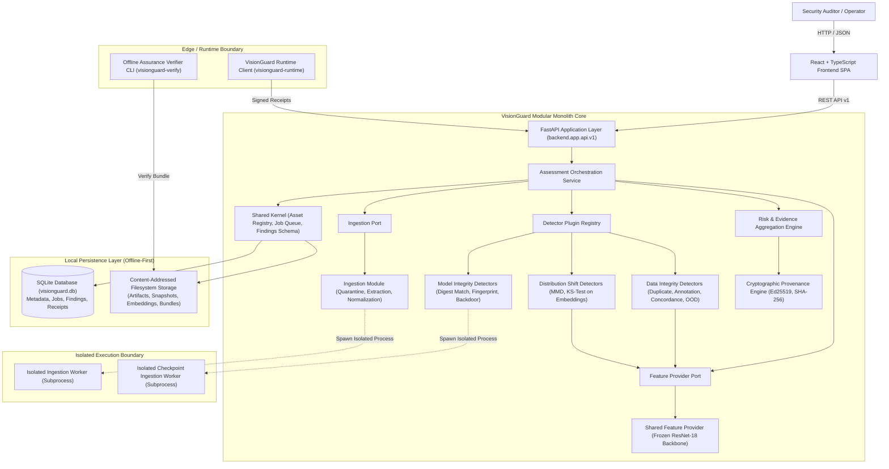
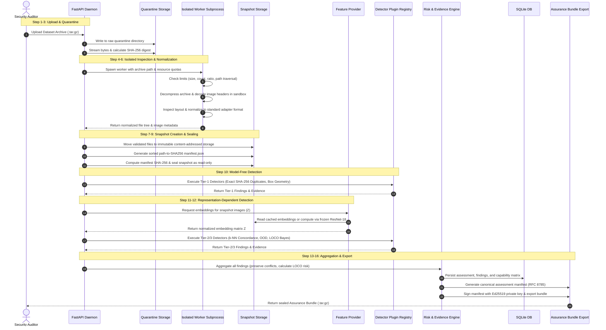

# VisionGuard System Architecture & Technical Specification

**Document Version:** 1.0.0 (Consolidated & Locked)  
**Status:** Authoritative Architectural Standard  
**Date:** November 2026  
**Architect:** Senior Software Architect & AI Security Engineer  
**Scope:** Authoritative system topology, modular monolith boundaries, ports and adapters, detector plugin registry, isolated worker contracts, end-to-end data flow, and deployment model.

---

## 1. System Overview & Architectural Style

VisionGuard is an offline-first AI lifecycle integrity and security assurance platform for computer vision systems. It evaluates computer vision datasets, deep-learning models, incoming data distributions, and edge inference events to provide evidence-backed assurance findings, cryptographic provenance, and contributor-level risk tracing.

### 1.1 Core Architectural Principles
1. **Modular Monolith:** All system modules reside in a single codebase with clean package boundaries. VisionGuard explicitly rejects microservices, container meshes, and distributed orchestrators.
2. **Ports and Adapters (Hexagonal Architecture):** Domain logic is insulated from storage mechanisms, API frameworks, machine-learning backbones, and OS process APIs through explicit interfaces (ports) and concrete implementations (adapters).
3. **Detector Plugin Registry:** Detectors adhere to a minimal common interface (`DetectorPlugin`), enabling independent unit testing, capability introspection, and modular activation without core refactoring.
4. **Isolated Subprocess Workers:** All untrusted I/O operations—archive decompression, image file decoding, dataset format normalization, and PyTorch checkpoint deserialization—execute in isolated worker subprocesses with strict resource quotas and capability gating.
5. **Shared Feature Provider:** Image embedding extraction is a centralized, on-demand service with content-addressed caching, preventing redundant neural network forward passes across detectors.
6. **Zero Runtime Network Dependency:** The system operates in air-gapped environments with 100% offline autonomy. Runtime downloads of weights, datasets, or licenses are prohibited.
7. **Strict PyTorch-Only Ecosystem:** PyTorch and TorchVision constitute the sole deep-learning framework stack (ADR-001). Competing frameworks (TensorFlow, Keras, ONNX, ONNX Runtime) are strictly prohibited.

---

## 2. High-Level System Architecture



---

## 3. Module Responsibilities & System Boundaries

### 3.1 Shared Kernel (`backend.app.core.kernel`)
The Shared Kernel defines the common domain language, core entities, and contracts used across all modules.
- **Asset Registry:** Canonical tracking of all ingested files, models, reference sets, and manifests. Maintains content-addressed asset identities (`asset_id`, `sha256`, `storage_path`, `size_bytes`, `metadata_json`).
- **Findings Schema:** Universal finding definition (`Finding`), evidence containers (`EvidenceRecord`), and severity taxonomies (`INFORMATIONAL`, `LOW`, `MEDIUM`, `HIGH`, `CRITICAL`).
- **Provenance Interfaces:** Contracts for canonical serialization (RFC 8785 JCS), SHA-256 digest computation, Ed25519 digital signature creation, and verification.
- **Job Management & State Store:** SQLite-backed queue tracking background task lifecycles (`QUEUED`, `RUNNING`, `COMPLETED`, `FAILED`) without requiring external brokers like Redis or Celery.
- **Common Status & Error Types:** Standardized capability execution states (`COMPLETED`, `NOT_APPLICABLE`, `UNAVAILABLE`, `SKIPPED`, `FAILED`, `TIMED_OUT`, `INCONCLUSIVE`, `CONFLICTED`) and structured domain exceptions.

### 3.2 Ingestion Module (`backend.app.modules.ingestion`)
Responsible for safely receiving, isolating, inspecting, and converting untrusted dataset archives into immutable, content-addressed snapshots.
- **Quarantine Management:** Ingests raw user archives (`.zip`, `.tar.gz`) directly into an isolated quarantine filesystem location (`data/quarantine/`). Raw data is never processed in place.
- **Secure Archive Extraction:** Spawns an ephemeral worker subprocess to extract archives with strict defensive checks: entry count limits, total uncompressed size caps, per-file size limits, path traversal elimination (`../`), symlink/hardlink rejection, and Windows reserved device name validation.
- **Image Validation & Decoding:** Validates magic bytes (JPEG `\xFF\xD8\xFF`, PNG `\x89PNG\r\n\x1a\n`), enforces decompression bomb caps ($40{,}000{,}000$ pixels), and rejects truncated or malformed image headers.
- **Dataset Format Adapters:** Concrete adapters for supported CV dataset layouts:
  - `COCODatasetAdapter`: Parses `annotations/*.json` instances; validates absolute pixel coordinates.
  - `YOLODatasetAdapter`: Parses `dataset.yaml` and normalized center bounding boxes; differentiates empty labels (negatives) from missing labels (orphans).
  - `FolderPerClassAdapter`: Ingests directory-based class partitions.
  - `CIFAR10BinaryAdapter`: Parses raw 3073-byte binary records with zero unpickling.
- **Immutable Dataset Snapshots:** Transforms validated datasets into content-addressed snapshot directories (`data/processed/snapshots/<snapshot_id>/`). Generates a lexicographically sorted path-to-SHA256 manifest (`manifest.json`), hashes the manifest to produce the `snapshot_digest`, and marks the snapshot read-only.

### 3.3 Feature Provider (`backend.app.modules.feature_provider`)
A centralized, on-demand domain service that provides deep visual representations across detection modules.
- **Shared Feature Extraction:** Computes 512-dimensional normalized feature vectors using a frozen, locally provisioned PyTorch ResNet-18 backbone (`torchvision.models.resnet18(weights=None)` loaded with verified local weights).
- **Backbone & Preprocessing Configuration:** Standardizes image normalization (mean $[0.485, 0.456, 0.406]$, std $[0.229, 0.224, 0.225]$) and resizing ($224 \times 224$) across all callers.
- **Embedding Cache:** Persists feature vectors in content-addressed storage keyed by `(sample_sha256, backbone_name, backbone_weights_sha256)`. Detectors requesting embeddings for previously processed images receive cached vectors instantly without re-executing neural network forward passes.
- **Cache Invalidation & Integrity:** Because cache keys include both the exact sample byte hash and backbone weights hash, cache corruption or stale embeddings across model updates are mathematically precluded.

### 3.4 Data Integrity Module (`backend.app.modules.data_integrity`)
Houses the concrete detectors evaluating dataset quality, structural hygiene, annotation validity, contamination, and contributor risks.
- **Exact Duplicate Detector:** Computes pairwise SHA-256 byte collisions in $O(N)$ time. Detects identical images within splits and cross-split train-val contamination (`CRITICAL_SPLIT_LEAKAGE`).
- **Near-Duplicate Detector:** Computes 64-bit perceptual hashes (pHash) via 2D Discrete Cosine Transform (DCT). Identifies visually redundant pairs across Hamming distances under calibrated threshold $\tau_H$.
- **Annotation Geometry Validator:** Evaluates bounding box coordinates according to format-specific rules (COCO absolute pixel boundaries vs. YOLO normalized unit bounds). Flags degenerate dimensions ($w \le 0, h \le 0$) and coordinate overflows.
- **Label Anomaly Detector:** Queries neighborhood concordance $C_k(i) = \frac{1}{k} \sum_{j \in \mathcal{N}_k(i)} \mathbb{I}(y_j = y_i)$ in deep feature space via adaptive $k$-d trees. Flags potential label noise and flipped annotations.
- **Dataset Contamination & OOD Detector:** Computes $k$-th nearest neighbor Euclidean distance in normalized feature space relative to an approved, authenticated reference set $\mathcal{D}_{\text{ref}}$.
- **Contributor Risk Analyzer:** Applies Leave-One-Contributor-Out (LOCO) empirical Bayes shrinkage to sample-level flags, calculating smoothed risk scores $R_{\text{smoothed}}$ with credible intervals and edge-case fallbacks.

### 3.5 Model Integrity Module (`backend.app.modules.model_integrity`)
Assesses PyTorch model checkpoints (`.pt`, `.pth`), verifying cryptographic integrity, architecture conformance, behavioral fingerprints, and potential backdoors.
- **Model File Digest Verifier:** Streams raw checkpoint bytes to compute SHA-256 digests; compares against approved deployment baselines or release manifests.
- **Unauthorized Modification Detector:** Analyzes state-dict tensor headers and weight summaries to distinguish re-saved models from genuine weight tampering.
- **Sandboxed Checkpoint Loader:** Dispatches untrusted checkpoint deserialization to an unprivileged subprocess executing `torch.load(weights_only=True)` under OS resource quotas. Strictly prohibits `weights_only=False`.
- **Post-Load State-Dict Validator:** Verifies that loaded objects are strictly instances of `dict[str, torch.Tensor]`, checks layer tensor dimensions against architecture specifications, and rejects astronomical shapes (DoS defense).
- **Behavioral Fingerprint Runner:** Evaluates candidate models against a deterministic suite of $M=100$ pseudo-random probes, measuring logit divergence $\Delta_{\max}$ against baseline outputs.
- **Experimental Backdoor Analyzers:** Houses research-grade trigger detectors (Spectral Signatures singular vector projection, Activation Clustering PCA/silhouette analysis). Explicitly tagged as experimental capabilities requiring model activations and clean holdout data.

### 3.6 Inference Integrity Module (`backend.app.modules.inference_integrity`)
Ensures end-to-end non-repudiation and auditability for edge inference predictions.
- **Lightweight Runtime Library (`visionguard-runtime`):** A standalone, zero-dependency Python package installable on edge inference nodes. Computes canonical request digests, captures predictions, and signs receipts locally.
- **Canonical Inference Receipts:** Generates deterministic JSON structures formatted according to RFC 8785 (JCS) and signed with Ed25519 private keys.
- **Receipt Verifier:** Recomputes input/output digests, validates cryptographic signatures against registered public keys, and verifies that claimed models produced claimed outputs.
- **Hash-Chain Auditor:** Chains receipts via `previous_receipt_hash` pointers and monotonic sequence numbers. Detects dropped, reordered, replayed, or injected events.

### 3.7 Distribution Shift Module (`backend.app.modules.distribution_shift`)
Monitors incoming operational data distributions for covariate and semantic drift without requiring task labels.
- **Feature Provider Integration:** Leverages the Shared Feature Provider to embed streaming production batches without duplicating model backbones.
- **Statistical Distance Testing:** Executes non-parametric two-sample divergence tests (Maximum Mean Discrepancy with Gaussian RBF kernels, Kolmogorov-Smirnov tests on feature projections, Wasserstein distances).
- **Drift vs. Accuracy Distinction:** Formulates drift findings strictly as distribution shift indicators; explicitly does not claim model performance degradation unless verified ground-truth labels are provided.

### 3.8 Risk & Evidence Aggregation Engine (`backend.app.modules.risk_engine`)
The core synthesis engine that aggregates findings from all active modules.
- **Evidence-Backed Synthesis:** Every finding is backed by an `EvidenceRecord` containing exact mathematical signals, sample digests, and threshold comparisons.
- **Severity & Confidence Decoupling:** Strictly differentiates between:
  - *Anomaly Score:* Normalized mathematical signal magnitude ($0.0 \dots 1.0$).
  - *Calibrated Confidence:* Statistical certainty given sample volume and test power.
  - *Severity Rating:* Mission criticality and operational impact (`LOW`, `MEDIUM`, `HIGH`, `CRITICAL`).
- **Visible Conflict Model:** When different detectors produce contradictory conclusions (e.g., pHash flags a duplicate while deep feature distance indicates an outlier), the engine preserves and highlights the conflict as `status: CONFLICTED` rather than silently averaging or masking evidence.
- **Assurance Bundle Generator:** Compiles assessment records, findings, and evidence references into a canonical assurance manifest sealed with an Ed25519 signature.

### 3.9 API, Worker & Frontend Layers
- **FastAPI API Layer (`backend.app.api`):** Thin HTTP REST controllers exposing versioned endpoints (`/api/v1`). Performs request validation via Pydantic schemas, routes commands to application services, and never executes heavy detector loops within request threads.
- **SQLite Job Worker (`backend.app.worker`):** An asynchronous background process that polls the SQLite `jobs` table, acquires task leases, invokes orchestrator pipelines, and writes progress state.
- **React + TypeScript Frontend (`frontend/`):** A client-side Single Page Application (SPA) providing asset management, assessment launching, finding inspection, evidence drilldown, and assurance bundle export.

---

## 4. Module Dependency Boundaries & Architectural Rules

```mermaid
graph TD
    subgraph Drivers["Driving Ports (Primary Adapters)"]
        CLI["CLI Commands"]
        API["FastAPI Routes (/api/v1)"]
        Worker["Job Worker Process"]
    end

    subgraph Application["Application Orchestration Layer"]
        Orchestration["Assessment Orchestration Service"]
    end

    subgraph DomainModules["Domain Modules (Detector Plugin Registry)"]
        DataMod["Data Integrity Module"]
        ModelMod["Model Integrity Module"]
        InfMod["Inference Integrity Module"]
        ShiftMod["Distribution Shift Module"]
        RiskMod["Risk & Evidence Engine"]
    end

    subgraph SharedServices["Shared Domain Services"]
        FeatureProv["Shared Feature Provider"]
        IngestionSvc["Ingestion & Snapshot Service"]
    end

    subgraph Kernel["Shared Kernel (Pure Domain / Zero Dependencies)"]
        Entities["Core Domain Entities & Schemas"]
        Ports["Repository & Crypto Interfaces"]
        Enums["Capability States & Finding Severities"]
    end

    subgraph Driven["Driven Ports (Secondary Adapters)"]
        SQLiteRepo["SQLite Database Adapter"]
        FSStore["Filesystem Storage Adapter"]
        IsolatedSubprocess["Subprocess Worker Isolation Adapter"]
        PyTorchBackbone["PyTorch Frozen Backbone Adapter"]
        CryptoAdapter["Python Cryptography (Ed25519/SHA-256)"]
    end

    Drivers --> Application
    Application --> DomainModules
    Application --> SharedServices
    Application --> Kernel

    DomainModules --> Kernel
    DomainModules --> FeatureProv
    SharedServices --> Kernel

    DomainModules -.->|Invoke via Adapter| IsolatedSubprocess
    SharedServices -.->|Invoke via Adapter| IsolatedSubprocess
    FeatureProv -.->|Load Weights| PyTorchBackbone

    Kernel <|.. SQLiteRepo
    Kernel <|.. FSStore
    Kernel <|.. CryptoAdapter
```

### Architectural Rules Governing Dependencies
1. **Unidirectional Dependency:** Dependencies flow inward toward the Shared Kernel. The Shared Kernel has zero imports from any domain module, API layer, or database implementation.
2. **Module Independence:** Domain modules (`data_integrity`, `model_integrity`, `inference_integrity`, `distribution_shift`) **must never import each other**. Cross-module coordination is handled exclusively by the Assessment Orchestration Service.
3. **Feature Provider Shared Port:** Modules needing image embeddings must invoke the `FeatureProviderPort` interface. Direct instantiation of deep learning models inside detectors is prohibited.
4. **Isolated Subprocess Boundary:** Ingestion archive extraction, image decoding, and model checkpoint unpickling must execute across an IPC boundary via the `WorkerIsolationAdapter`. The main API daemon never directly opens untrusted `.tar.gz` archives or calls `torch.load()`.
5. **Database Decoupling:** Detectors receive plain Python domain models and return finding dataclasses; detectors never execute SQL queries or import SQLAlchemy/SQLite sessions directly.

---

## 5. End-to-End Assessment Data Flow

The canonical end-to-end flow executes in 16 discrete, audited steps. Each step operates within a designated trust boundary:



### Detailed Step-by-Step Flow & Trust Boundaries

| Step | Operation | Execution Context | Trust Boundary | Security Controls & Guarantees |
|---|---|---|---|---|
| **1** | Receive dataset archive | API Daemon (`backend.app.api`) | Untrusted $\to$ System Perimeter | File size validated ($\le 250$ MB); MIME-type checked. |
| **2** | Place in quarantine | Filesystem (`data/quarantine/`) | Isolated Quarantine Area | Stored under generated UUID; original filename untrusted. |
| **3** | Stream SHA-256 digest | Quarantine Storage | Quarantine Area | Streams 64 KB blocks; computes content identity hash. |
| **4** | Safely inspect & extract | Ephemeral Worker Subprocess | **Isolated Sandbox Worker** | Limits: max 50,000 files, 10 GB uncompressed, 10:1 ratio. Path traversal, symlinks, Windows reserved names blocked. |
| **5** | Decode images & check headers | Ephemeral Worker Subprocess | **Isolated Sandbox Worker** | Validates magic bytes; Pillow `MAX_IMAGE_PIXELS = 40M` prevents decompression bombs. |
| **6** | Normalize dataset format | Ephemeral Worker Subprocess | **Isolated Sandbox Worker** | Adapter normalizes COCO/YOLO/Folder into uniform internal sample records. |
| **7** | Create immutable snapshot | Filesystem (`data/processed/snapshots/`) | Validated Internal Storage | Files moved to content-addressed directory; permissions set read-only (`0444`). |
| **8** | Generate sorted manifest | Snapshot Directory | Validated Internal Storage | Paths sorted lexicographically (UTF-8 byte order); pairs relative path to file SHA-256. |
| **9** | Hash and seal manifest | Snapshot Storage & SQLite | Validated Internal Storage | Computes `snapshot_digest = SHA256(manifest.json)`. Registered in SQLite Asset Registry. |
| **10** | Execute Tier-1 detectors | API / Worker Task Pool | Internal Core Domain | Model-free checks: exact byte deduplication, COCO/YOLO annotation coordinate validation. |
| **11** | Request shared features | Feature Provider Port | Internal Core Domain | Queries embedding cache; computes missing features via frozen PyTorch ResNet-18. |
| **12** | Execute Tier-2/3 detectors | API / Worker Task Pool | Internal Core Domain | Feature $k$-NN concordance, reference OOD scoring, LOCO empirical Bayes shrinkage. |
| **13** | Aggregate evidence & conflicts | Risk & Evidence Engine | Internal Core Domain | Merges evidence without averaging away opposing signals; conflicting outputs marked `CONFLICTED`. |
| **14** | Generate finding reports | Risk & Evidence Engine | Internal Core Domain | Produces structured finding schema, capability coverage matrix, and suggested dispositions. |
| **15** | Seal assessment manifest | Cryptographic Provenance Module | Cryptographic Security Boundary | Canonical RFC 8785 JSON serialized and signed with Ed25519 assessment private key. |
| **16** | Export assurance bundle | Assurance Bundle Exporter | Verified Output Boundary | Self-contained archive (`bundle.tar.gz`) containing snapshot manifest, findings, and signature. |

---

## 6. Detector Plugin Interface Specification

All detectors in VisionGuard adhere to a minimal, uniform interface defined in the Shared Kernel:

```python
from abc import ABC, abstractmethod
from dataclasses import dataclass
from typing import Any
from backend.app.core.kernel.entities import (
    AssetSnapshot,
    CapabilityStatus,
    EvidenceRecord,
    Finding,
)


@dataclass(frozen=True)
class DetectorRequirements:
    """Defines prerequisites necessary for detector execution."""

    requires_labels: bool
    requires_embeddings: bool
    requires_model_checkpoint: bool
    requires_reference_set: bool
    requires_provenance: bool


@dataclass(frozen=True)
class DetectorResult:
    """Standard execution output returned by every detector."""

    status: CapabilityStatus
    status_reason: str | None
    findings: list[Finding]
    evidence: list[EvidenceRecord]
    metadata: dict[str, Any]


class BaseDetector(ABC):
    """Universal plugin interface for VisionGuard integrity detectors."""

    @property
    @abstractmethod
    def detector_id(self) -> str:
        """Unique dot-delimited identifier (e.g., 'data_integrity.exact_duplicate')."""
        ...

    @property
    @abstractmethod
    def version(self) -> str:
        """Semantic version of the detector implementation."""
        ...

    @property
    @abstractmethod
    def requirements(self) -> DetectorRequirements:
        """Explicit declaration of required assets and inputs."""
        ...

    @abstractmethod
    def evaluate(
        self,
        snapshot: AssetSnapshot,
        embeddings: Any | None = None,
        reference_embeddings: Any | None = None,
        model_checkpoint: Any | None = None,
        config: dict[str, Any] | None = None,
    ) -> DetectorResult:
        """Executes the detection algorithm and returns structured results."""
        ...
```

---

## 7. Deployment & Operational Architecture

### 7.1 Single-Node Modular Topology
VisionGuard is deployed as a single-node application. It runs either as a single self-contained Docker container or as a native host installation.

```text
┌─────────────────────────────────────────────────────────────┐
│ VisionGuard Host / Container Deployment Environment         │
│                                                             │
│   ┌─────────────────────────────────────────────────────┐   │
│   │ Reverse Proxy / Static File Server (Nginx / Caddy) │   │
│   │ Serves compiled React UI; proxies /api to FastAPI   │   │
│   └──────────────────────────┬──────────────────────────┘   │
│                              │                              │
│   ┌──────────────────────────▼──────────────────────────┐   │
│   │ FastAPI Web Application Daemon (Port 8000)          │   │
│   │ Uvicorn worker process; non-blocking API routing    │   │
│   └──────────────────────────┬──────────────────────────┘   │
│                              │                              │
│   ┌──────────────────────────▼──────────────────────────┐   │
│   │ SQLite-Backed Background Job Worker (1 process)     │   │
│   │ Polls jobs table; manages assessment executions     │   │
│   └───────────────┬─────────────────────────┬───────────┘   │
│                   │                         │               │
│   ┌───────────────▼───────────┐ ┌───────────▼───────────┐   │
│   │ Isolated Subprocess Worker│ │ Isolated Subprocess   │   │
│   │ (Ingestion / Decompress)  │ │ (Model Safe Loader)   │   │
│   └───────────────────────────┘ └───────────────────────┘   │
│                   │                         │               │
│   ┌───────────────▼─────────────────────────▼───────────┐   │
│   │ Local Filesystem & SQLite Database                  │   │
│   │ visionguard.db, data/quarantine, data/processed     │   │
│   └─────────────────────────────────────────────────────┘   │
└─────────────────────────────────────────────────────────────┘
```

### 7.2 Air-Gapped Provisioning Requirements
To operate with 100% offline autonomy, deployment follows a strict two-stage process:
1. **Pre-Deployment Asset Staging (Connected Environment):**
   - Python dependencies pinned in `requirements.txt` and wheels packaged locally.
   - ResNet-18 weights (`resnet18-f37072fd.pth`) downloaded and cryptographic SHA-256 verified against upstream PyTorch records.
   - Base Docker image (`python:3.11-slim`) built and exported via `docker save`.
2. **Operational Deployment (Air-Gapped Target Environment):**
   - Container image imported via `docker load`.
   - Verified ResNet-18 weights mounted at `/opt/visionguard/models/backbones/resnet18.pth`.
   - Outbound internet access disabled at the OS firewall / virtual network level.
   - Zero runtime network pings, telemetry, or remote lookups are executed.
